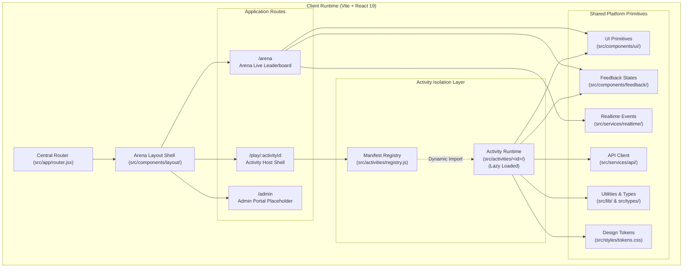
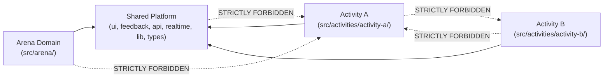

# DevFest Ranchi 2026 Gaming Arena — Frontend Architecture

> **Author:** Frontend Architecture & Engineering Lead  
> **Target Audience:** Core Maintainers, Platform Engineers, Activity Developers  
> **Status:** Initial Foundation Established  
> **Design Authority:** `design.md` (DevFest Ranchi 2026 Neo-Brutalist Design System)

---

## 1. Project Purpose & Scope

The DevFest Ranchi 2026 Gaming Arena is a dedicated, interactive developer pavilion hosted at Central & Eastern India's flagship developer conference on **October 31, 2026**. 

The Arena experience provides:
1. **Live Leaderboard Display (`/arena`):** A public, auditorium-projectable display visualizing real-time standings, track categories, and challenge rankings.
2. **Participant Activity Interface (`/play/:activityId`):** The isolated runtime shell where conference attendees tackle individual technical challenges.
3. **Event Administration Portal (`/admin`):** A restricted management cockpit for track leads and event organizers.

The frontend is architected to allow **independent developers** to contribute separate activities concurrently without merge conflicts, global state coupling, or cross-module fragility.

---

## 2. Architecture Overview & Principles



### Core Architectural Principles
1. **One Application, Isolated Workspaces:** Single repository and Vite application; each activity lives in its own sandboxed folder under `src/activities/<activity-id>/`.
2. **Zero Activity-to-Activity Coupling:** An activity must never import files from any other activity.
3. **Downward-Only Shared Dependency Flow:** Activities consume shared platform primitives (`ui`, `feedback`, `api`, `realtime`, `lib`), but shared platform code never imports activity implementations.
4. **Decoupled Leaderboard:** The live leaderboard never executes or embeds activity code to determine standings. All score updates flow through centralized event channels.
5. **On-Demand Code Splitting:** Activity code is strictly dynamic (`React.lazy`) and loaded only when a participant accesses that challenge's route.

---

## 3. Directory Responsibilities

```text
game-arena/
├── public/                     # Static assets (favicons, SVG icon spritesheets)
├── docs/                       # Architectural & contributor documentation
│   ├── ARCHITECTURE.md         # Master architecture blueprint (this document)
│   ├── CONTRIBUTING.md         # Team conventions, Git workflows, PR requirements
│   ├── DESIGN_SYSTEM.md        # Neo-brutalist token & UI specification
│   └── ACTIVITY_DEVELOPMENT.md # Activity creation guide & schema contract
│
├── src/
│   ├── app/                    # Application foundation & root composition
│   │   ├── App.jsx             # Root React component
│   │   ├── router.jsx          # Centralized React Router configuration
│   │   └── providers.jsx       # Global context providers tree
│   │
│   ├── arena/                  # Live Arena Leaderboard domain
│   │   ├── pages/              # /arena route screens (ArenaPage, NotFoundPage)
│   │   ├── components/         # Leaderboard podium, rank bars, filter pills
│   │   └── hooks/              # Arena leaderboard data fetching & filter hooks
│   │
│   ├── activities/             # Independent activity sandboxes
│   │   ├── registry.js         # Central activity manifest registry
│   │   ├── ActivityHost.jsx    # Generic lazy-loading activity host
│   │   └── README.md           # Activity development constraints
│   │
│   ├── admin/                  # Future event administration domain
│   │   ├── pages/              # /admin dashboard views
│   │   └── README.md           # Admin scope documentation
│   │
│   ├── components/             # Shared platform UI primitives
│   │   ├── ui/                 # Neo-brutalist buttons, cards, badges
│   │   ├── layout/             # Master ArenaLayout, Navbar
│   │   └── feedback/           # LoadingState, ErrorState, EmptyState
│   │
│   ├── services/               # Infrastructure & networking
│   │   ├── api/                # Native fetch client & endpoint wrappers
│   │   └── realtime/           # Pub/sub connection manager & event contracts
│   │
│   ├── hooks/                  # Global, cross-application React hooks
│   ├── lib/                    # Pure utility functions (cn, formatters)
│   ├── types/                  # JSDoc contracts (ActivityManifest, Status)
│   ├── assets/                 # Shared global brand vectors and icons
│   ├── styles/                 # Design token CSS custom properties
│   │   └── tokens.css          # Hex codes, brutalist shadows, borders, radii
│   │
│   ├── index.css               # Tailwind v4 import, theme maps, base rules
│   └── main.jsx                # DOM mounting entry point
│
├── eslint.config.js            # Boundary lint enforcement & React 19 rules
├── index.html                  # HTML5 shell & Plus Jakarta Sans typography
├── package.json                # React 19, Tailwind v4, React Router
└── vite.config.js              # Vite bundler with @tailwindcss/vite plugin
```

---

## 4. Routing Architecture & Ownership

Routing is centralized in [router.jsx](file:///c:/Workspace/ByteLab/game-arena/src/app/router.jsx) and rendered inside the persistent [ArenaLayout](file:///c:/Workspace/ByteLab/game-arena/src/components/layout/ArenaLayout.jsx).

| Route | Responsible Component | Description |
| :--- | :--- | :--- |
| `/` | `Navigate to="/arena"` | Root redirection to default arena leaderboard. |
| `/arena` | `ArenaPage` | Live leaderboard public projection screen. |
| `/play/:activityId` | `ActivityHost` | Dynamic host shell that resolves and mounts registered activities. |
| `/admin` | `AdminPage` | Restricted administration portal for challenge coordinators. |
| `*` | `NotFoundPage` | Neo-brutalist 404 catch-all view. |

### Adding Activities Without Router Edits
Activity developers **never modify `src/app/router.jsx`**. The router defines the parameterized path `/play/:activityId`. When a participant navigates to `/play/my-challenge`:
1. `ActivityHost` extracts `activityId = "my-challenge"` from route params.
2. It looks up the ID in [registry.js](file:///c:/Workspace/ByteLab/game-arena/src/activities/registry.js).
3. If unknown: renders an accessible Neo-brutalist `ErrorState` ("Unknown Activity").
4. If status is `draft` or `disabled`: displays a preparation notice.
5. If status is `active`: asynchronously dynamic-imports the activity bundle using `React.lazy` inside `<Suspense fallback={<LoadingState />} />`.

---

## 5. Strict Module Dependency Boundaries

To safeguard team parallelization, import restrictions are strictly enforced at both architectural and lint levels:



- **Rule 1 (Isolation):** An activity may only import its own internal files or approved shared modules (`src/components/`, `src/services/`, `src/hooks/`, `src/lib/`, `src/types/`, `src/styles/`).
- **Rule 2 (No Cross-Activity Imports):** An activity must NEVER import another activity's internal files. Enforced by ESLint rule `'no-restricted-imports'` in [eslint.config.js](file:///c:/Workspace/ByteLab/game-arena/eslint.config.js).
- **Rule 3 (No Reverse Activity Imports):** Shared code and the Arena domain must never import activity implementations.
- **Rule 4 (No Router / Shell Tampering):** Activities must never modify `App.jsx`, `router.jsx`, `ArenaLayout.jsx`, or global stylesheets.

---

## 6. Shared Platform Responsibilities

### UI Primitives (`src/components/ui/`)
- Pure presentation building blocks styled according to `design.md`.
- Implements tactile press mechanics (`hover:translate-x-[2px]`, `active:translate-x-[4px]`).
- Adheres to standard Google brand hex codes and solid black brutal borders.

### Feedback UI (`src/components/feedback/`)
- Universal states for `LoadingState`, `ErrorState`, and `EmptyState`.
- Incorporates accessible ARIA roles (`role="status"`, `role="alert"`).

### API Client (`src/services/api/`)
- Zero external networking libraries (no Axios).
- Standardized native Web Fetch wrapper with base URL injection and consistent error structures.

### Realtime Infrastructure (`src/services/realtime/`)
- Event pub/sub abstraction. Provides clean subscriptions for live scoring without requiring active network transport during early development.

---

## 7. Deferred Concerns & Explicit Non-Goals

In keeping with progressive engineering discipline:
- **No Mock Leaderboards:** Fabricated scores or mock participant tables are avoided to prevent misleading attendees or biasing testing.
- **No Premature State Management:** Redux, Zustand, or React Query are deliberately omitted. Local state and lightweight context suffice at this stage.
- **No Early WebSocket Connections:** Realtime socket connections are deferred until backend event infrastructure is deployed.
- **No Micro-Frontends / Monorepos:** Unnecessary build complexity is avoided in favor of clean internal workspace folders within a single Vite application.
